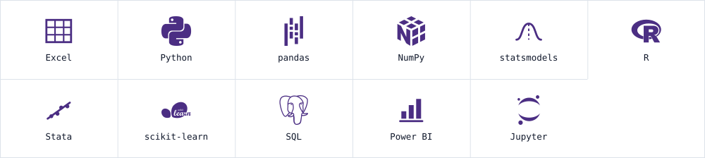

<picture><source media="(prefers-color-scheme: dark)" srcset="assets/dark/header.svg"/></picture>

<a href="mailto:shaswatsharma.work@gmail.com"><picture><source media="(prefers-color-scheme: dark)" srcset="https://img.shields.io/badge/EMAIL-0d1117?style=flat-square&logo=maildotru&logoColor=ffffff"/></picture></a>
<a href="https://www.linkedin.com/in/shaswatsharma49"><picture><source media="(prefers-color-scheme: dark)" srcset="https://img.shields.io/badge/LINKEDIN-0d1117?style=flat-square&logo=linkedin&logoColor=ffffff"/></picture></a>

<picture><source media="(prefers-color-scheme: dark)" srcset="assets/dark/toolkit.svg"/></picture>

<picture><source media="(prefers-color-scheme: dark)" srcset="assets/dark/s-work.svg"/></picture>

<picture><source media="(prefers-color-scheme: dark)" srcset="assets/dark/showcase.svg"/></picture>

<table>
<tr><td width="100%">

### [Zepto — Pre-IPO Valuation](https://github.com/theshaswat/zepto-pre-ipo-valuation)

**$3.8bn base case against a $7.0bn private mark.** Built before the roadshow range was consulted; the resulting $2.7–5.5bn range brackets what institutions actually indicated ($3.0–3.5bn domestic, $4.5bn foreign).

Zepto, Blinkit and Instamart disclose on three incompatible bases — 1P inventory against 3P commission — making headline revenue comparisons wrong by roughly 4.3x. Restated onto net order value, the binding constraint was never store density: Zepto runs the highest orders per store per day of the three (1,618) and the weakest basket (₹388, against ₹518 and ₹508). About 4 percentage points of the headline cut is rupee depreciation rather than fundamentals.

`relative valuation` `unit economics` `scenario & sensitivity` `fx decomposition` `Excel` `Python` `pandas`

</td></tr>
<tr><td width="100%">

### [Sun Pharma / Organon — Merger Arbitrage](https://github.com/theshaswat/sunpharma-organon-merger-arbitrage)

**Pass on the spread.** Standalone DCF puts Organon at $6.90 against a $14.00 offer — $1.86bn of synergy management never disclosed, requiring 3.87% revenue growth against an actual −0.38% two-year CAGR.

The spread implies 93.9% completion probability. A seeded 100,000-path Monte Carlo returns a mean annualised 0.07% against a 4.62% risk-free rate: the position is not paid for the risk it carries. Sun Pharma's own announcement CAR was +9.6% and statistically significant, which is the evidence that cuts hardest against the standalone valuation.

`DCF & reverse-DCF` `event study` `GARCH(1,1)` `Granger causality` `Monte Carlo` `Black-Scholes` `statsmodels`

</td></tr>
<tr><td width="100%">

### [PayPal — Fairness Valuation vs. the Stripe/Advent Bid](https://github.com/theshaswat/paypal-stripe-advent-ma-valuation)

**$60.50 sits below the floor of all three methods.** DCF bear case $73.85, trading comps $76.69, precedent-transaction floor $64.88. Making the base case agree with the offer requires a 13.4% discount rate against a calculated 9.67% WACC.

A reverse DCF makes the same point from the other side: the $47.37 unaffected close implies ~17%, or five straight years of −11.6% revenue decline — neither consistent with reported results or guidance. That reads the pre-news price as a sentiment floor, not an intrinsic-value anchor.

`DCF` `trading comps` `precedent transactions` `sources & uses` `football field` `Excel` `Python`

</td></tr>
<tr><td width="100%">

### [ACC Limited — Dividend vs. Earnings Event Study](https://github.com/theshaswat/acc-dividend-event-study)

**A 68% profit miss moved the stock less than a 20% miss did the year before.** Same Rs 7.50 dividend, bundled with results both times — the reaction tracked the surprise, not the size of the miss.

FY25's decline arrived with no precedent and produced a significant, lasting −5.7% three-day CAR (market model), −5.8% under Fama-French three-factor. FY26's much larger decline had been signalled for months; its −3.0% initial reaction had fully reverted to +0.2% within two weeks — consistent with the cost pressure being priced in ahead of the print.

`event study` `market model` `Fama-French 3-factor` `Brown-Warner t-test` `Python` `statsmodels`

</td></tr>
<tr><td width="100%">

### [Situational Awareness — Forced-Deleveraging Forensics](https://github.com/theshaswat/situational-awareness-unwind)

**Put-linked exposure fell from 62% of gross to 0.03% in the quarter before the fund lost 67%.** The published accounts of the July 2026 collapse attribute it to 4x leverage. Seven quarters of 13F filings show the fund also entered July with no disclosed downside protection, having held $8.46bn of puts three months earlier; two positions, Micron and TSMC, flipped from a put to a larger long on the same issuer between filings.

Days-to-liquidate built from position size against trailing volume put the book at 1.55 days, which reads as liquid. The single name it flagged, Core Scientific at 9.25 days, is the one a Schedule 13D/A shows still being sold by block trade five days after the main unwind, 12.2% below its mid-July prints. Tested out-of-sample the screen initially failed: Berkshire's concentration exceeds Melvin Capital's before GameStop, because Melvin's risk sat in swaps a 13F cannot see. That result is why the live screen scores concentration trend alongside level rather than level alone.

`13F reconstruction` `liquidity & days-to-liquidate` `return attribution` `out-of-sample validation` `SEC EDGAR` `Python`

</td></tr>
<tr><td width="100%">

### [Private Banks — Margin & Credit-Cost Bridge](https://github.com/theshaswat/bank-nim-credit-cost-bridge)

**Every margin that is disclosed narrowed, and all four banks grew profit anyway.** Provisions are the line that reconciles those two facts — three of the four publish a net interest margin and all three fell in the June 2026 quarter. But the four did not get there the same way: decomposing each bank's change in profit across net interest income, other income, operating expenses, provisions and tax puts provisions first at Axis and HDFC, and net interest income first at Kotak and ICICI.

HDFC is the clearest case and the one most likely to be misread: provisions fell ₹11,380 Cr, worth 62.7 points of profit growth against a headline of 5.0, while other income fell ₹8,910 Cr because the prior-year quarter carried a one-time gain on the HDB Financial Services divestment. Four reconciliation checks run before any comparison is computed and the bridge is not written unless all four pass — an NII tie-out, computed growth against the growth each bank printed itself, a five-line P&L walk to reported PAT, and the attribution closing on the change in profit. Tolerances come from each bank's own reporting precision rather than being chosen, and the P&L figures were extracted twice, independently, with the second pass locating each table by content rather than by the page number the first pass recorded.

`P&L attribution` `reconciliation` `PDF table extraction` `Python` `pandas` `pdfplumber`

</td></tr>
<tr><td width="100%">

### [EPC Contractors — Earnings-Quality Screen](https://github.com/theshaswat/epc-earnings-quality-screen)

**Two of four reported FY26 profit while operating cash flow was negative.** NCC booked ₹724 Cr of profit against −₹459 Cr of operating cash, KEC ₹606 Cr against −₹414 Cr. Ranked on Sloan (1996) total accruals — profit less operating cash, over average total assets — those two sit at the low-quality end at +5.03% and +4.31%, and PSP Projects at the other, with operating cash 5.8x its profit.

L&T's ratio is +0.53%, but only once group profit is used rather than the attributable figure. The attributable line excludes ₹2,870 Cr of profit belonging to non-controlling interests while the cash flow and the asset base it is measured against are both consolidated, and mixing the two bases flips the sign of the result — an earlier revision of this screen had it the wrong way round and called L&T the cleanest of the four.

`Sloan accruals` `earnings quality` `balance-sheet reconciliation` `Python` `pandas` `pdfplumber`

</td></tr>
<tr><td width="100%">

### [Indian AMCs — Retail-Investing Sector Call](https://github.com/theshaswat/great-indian-financialization)

**SIP inflows run about 8x their FY17 level, and only 9.5% of Indian households invest.** RBI's savings data has physical assets rising from 59.7% to 71.5% of household savings while the Economic Survey has equity's share of financial savings going from about 2% to over 15%. Both hold, because they divide by different things: the shift is a reshuffle inside a shrinking financial-savings slice. The geography says the same. Cities beyond the top 30 hold 19.1% of mutual-fund AUM but supply 55–60% of new SIP registrations.

The part of the boom that threatens incumbents runs through two brokers. Groww and Zerodha hold about 80% of retail equity investors, and their fund houses grew 2.85x and 2.66x in a year while still under 2% of HDFC AMC's assets. Scored on margin cushion and AUM growth, the four listed AMCs come out HDFC Neutral, Nippon India Underweight, UTI Neutral, and ABSL Neutral at low confidence, since ABSL's figures are on a different period basis than the other three. PAT margin stands in for distribution cost in that score, because distribution expense isn't disclosed consistently across the four.

`data reconciliation` `exposure scorecard` `scenario analysis` `sector call` `Python` `pandas` `matplotlib`

</td></tr>
<tr><td width="100%">

### [Procure-to-Pay — Internal Audit Risk & Control Matrix](https://github.com/theshaswat/p2p-internal-audit-rcm)

**2,175 of 70,817 paid items look like duplicate payments, and 5,149 of 217,772 had the same person create the order and record its goods receipt.** Six SQL tests ran over all 251,734 items of a real purchase-order log (BPI Challenge 2019) against a ten-risk control matrix. The three-way-match tests came back clean: 109 invoices cleared with no net goods receipt and 87 cleared before the first receipt, both under 0.1%. Overall conclusion: needs improvement, five findings, one rated High.

The log holds one value per item rather than separate receipt and invoice amounts, so three-way match is tested on event sequence, and the duplicate hits are leads to check against invoices, not confirmed losses. Two assumptions are mine and stated: the 10,000 approval limit and the 7-day duplicate window. A first version of the payment-without-receipt test counted reversals as payments; spot-checking cases caught it, and the test now excludes them.

`internal audit` `risk & control matrix` `three-way match` `segregation of duties` `SQL` `DuckDB`

</td></tr>
<tr><td width="100%">

### [Revenue Assurance — Leakage Review](https://github.com/theshaswat/revenue-assurance-leakage-review)

**R$ 317k of leakage on R$ 15.4m billed, and 93% of it is voucher discounts above the cap.** 96,470 delivered Olist orders reconciled across order lines, delivery dates and payments. Billed and collected agree to within R$ 2,688, so unbilled orders are negligible (R$ 341 across 18 orders); the exposure is discounts (R$ 295,795) and prices billed more than 10% below list (R$ 21,239).

Olist has no price list or discount policy, so the 10% price tolerance and the 10% voucher cap are mine; the report shows the result at 5% and 20%, and the discount figure moves between R$ 319k and R$ 252k across that range. Each leakage type has its own one-page SOP, and the control checklist is ranked by value at risk.

`revenue assurance` `reconciliation` `SOPs & controls` `Python` `pandas` `Excel`

</td></tr>
<tr><td width="100%">

### [Olist — Unit Economics, LTV & Cross-Sell Propensity](https://github.com/theshaswat/unit-economics-cac-ltv)

**55% of won sellers never sold a single item.** 842 of 8,000 marketing-qualified leads became signed sellers; only 379 of those ever listed anything. A channel-ROI conversation that stops at win rate is measuring the wrong step — paid search brings in roughly a third fewer leads than organic search (1,586 against 2,296) and still scores higher (0.71 against 0.63) once activation and realised GMV are counted.

The same gap runs through the buyer side. 97% of customers buy exactly once, so cohort margin per customer moves from R$111.41 at first purchase to R$123.45 twelve months later — a 10.8% lift produced entirely by the 3% who return, which makes retention the lever rather than lifetime-value expansion. What separates a profitable segment from an unprofitable one is freight, not price: electronics runs 31.5% margin because freight consumes 68.6% of item price, against 83.0% on watches_gifts at comparable volume, and the Amazon-region states fall to ~40% on distance alone. No dollar CAC is reported, because Olist discloses no marketing spend by channel and no outside benchmark was substituted for it.

`cohort LTV` `acquisition funnel` `contribution margin` `logistic propensity` `out-of-time validation` `scikit-learn` `Plotly`

</td></tr>
<tr><td width="100%">

### [Bank LCR & Funding Concentration](https://github.com/theshaswat/bank-lcr-funding-concentration)

**The bank with the lower headline LCR has the more retail-anchored funding base.** HDFC Bank and IndusInd Bank both clear RBI's 100% minimum every quarter — reconstructing five quarters of both banks' own Pillar 3 disclosures line by line shows IndusInd's higher ratio (126.66% vs. 115.00%, latest quarter) sits on 40.9% wholesale funding against HDFC's 33.1%, and less-stable deposits at 95.3% of its retail base against 77.6%.

`Basel III LCR` `PDF table extraction` `regulatory reconciliation` `funding-mix analysis` `Python` `pandas` `pdfplumber`

</td></tr>
<tr><td width="100%">

### [Campaign ROI & Media Spend Simulator](https://github.com/theshaswat/campaign-roi-media-spend-simulator)

**Display campaigns don't clear break-even; Shopping/Sponsored campaigns clear it at ~₹22,800 of spend.** Built from published 2026 India ad-tech benchmarks rather than invented assumptions — incremental ROAS of 0.94x for Display against 4.29x for Shopping, cross-validated between an independent Python model and a live-formula Excel workbook to the cent.

`funnel modeling` `break-even & sensitivity analysis` `Excel` `Python` `openpyxl`

</td></tr>
<tr><td width="100%">

### [Indirect Tax Classification & Reconciliation Engine](https://github.com/theshaswat/indirect-tax-classification-reconciliation)

**A wrong or stale tax code on the vendor master is the most common root cause of an exception queue.** A rules engine classifies synthetic AP invoice lines against 20 sourced rate rules across 11 jurisdictions (GST, India TDS, US state Sales & Use Tax, EU VAT), independently re-derives the correct code, and flags mismatches — a 33.3% exception rate matching the 1-in-3 error-injection rate exactly, once a data-generator bug was found and fixed.

`GST` `VAT` `sales & use tax` `rules engine` `reconciliation` `Python`

</td></tr>
<tr><td width="100%">

### [Retail Media Monetization Benchmark, India](https://github.com/theshaswat/retail-media-monetization-benchmark-india)

**Two of three marketplaces disclose a number that's easy to mistake for ad revenue but is actually the opposite side of the transaction.** Benchmarking ad-revenue-as-%-of-GOV for Swiggy, Nykaa and Eternal from public disclosures alone, only Swiggy discloses it cleanly (≥4% of Food Delivery GOV); Nykaa and Eternal disclose their own ad **spend** ("AdEx") instead, which this project records separately rather than substituting in.

`retail media` `public-disclosure benchmarking` `Python`

</td></tr>
</table>

<picture><source media="(prefers-color-scheme: dark)" srcset="assets/dark/s-method.svg"/></picture>

One registry holds every externally-sourced figure, tagged by provenance tier; nothing else
contains a typed-in number, so the memo, the notebooks, the deck and the model cannot drift
apart. Where a deliverable does carry typed-in figures, as the AMC sector call's dashboards and
deck do, CI checks every one of them against the registry at the precision it is written. Every repository here carries its own verification suite and runs it in CI on each push,
and each workflow says in its own header what it does and does not prove. The Zepto build rebuilds
all nine notebooks, the deck, the PDFs and the workbook from source and re-audits the result; the
PayPal build asserts every committed output still reproduces byte-for-byte; the unit-economics
build re-derives the seller funnel from the raw CSVs and fails if the headline 8,000 to 842 to 379
ever stops holding. Primary sources are pinned by SHA-256 rather than redistributed, so a reader
can prove they hold the same document the figures were read from without me republishing somebody
else's annual report.

Limitations are written down rather than omitted, including corrections made mid-analysis where
an earlier draft was wrong. Two of the three recorded in the Zepto memo are errors a reader
working from secondary coverage would reproduce.

<picture><source media="(prefers-color-scheme: dark)" srcset="assets/dark/s-next.svg"/></picture>

Work in progress extends the same standard to a wider toolset: SQL-backed pipelines so the
registry is queried rather than typed, econometric work carried in R and Stata alongside Python,
and a reporting layer in Power BI. Each ships with the same verification suite and the same
written limitations as the work above.

<picture><source media="(prefers-color-scheme: dark)" srcset="assets/dark/s-activity.svg"/></picture>

<picture><source media="(prefers-color-scheme: dark)" srcset="https://raw.githubusercontent.com/theshaswat/theshaswat/output/snake-dark.svg"/></picture>

Independent research. Not investment advice.
